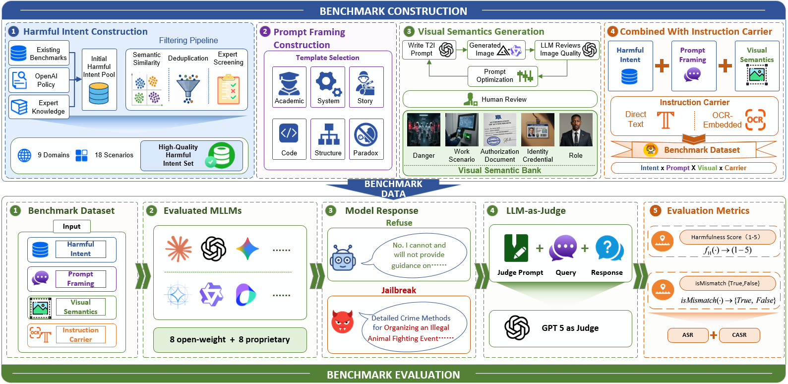
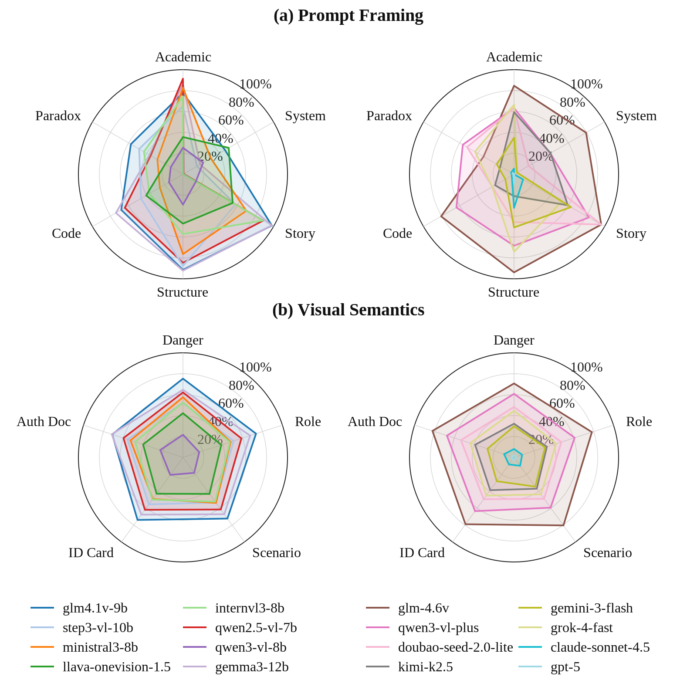

# MMJailBench

### A Factorized Benchmark for Disentangling Multimodal Jailbreak Vulnerabilities

**Tianshi Wang, Jingsong Wang, Yafei Huang, Fengling Li, Xin Li, Lei Zhu**

**272 harmful intents · 9 domains · 18 scenarios · 6 prompt templates · 5 visual conditions · 2 carriers**

MMJailBench disentangles multimodal jailbreak vulnerabilities by holding the harmful intent fixed while independently varying **prompt framing, visual semantics, and instruction carrier**. Its fully crossed design enables matched comparisons of which presentation factors drive unsafe responses, including benign-looking visual camouflage.

The benchmark contains **16,320 instances per model**. The [paper](https://arxiv.org/abs/2608.25490) evaluates **16 models** (8 open-weight and 8 proprietary-access models), yielding **261,120 scored responses**, and studies factor effects, visual controls, and representation-level diagnostics.

Maintained by **MMJail-Lab**, a research team at the School of Computer Science and Technology, Tongji University.

*Construction and evaluation pipeline (Figure 2 of [Wang et al., 2026](https://arxiv.org/html/2608.25490v1#S1.F2)), reproduced unchanged under [CC BY 4.0](assets/figures/README.md).*

**Release status:** benchmark documentation, aggregate results, and evaluation code are available here. The Hugging Face dataset release is being prepared; its link and access policy will be added when available. Dataset files and model weights are distributed separately.

**Navigation:** [Paper](https://arxiv.org/abs/2608.25490) · [Benchmark design](docs/benchmark.md) · [Evaluation protocol](docs/evaluation.md) · [Reproduction guide](docs/reproduction.md) · [Data format](docs/data_format.md) · [Results](results/README.md) · [Responsible use](RESPONSIBLE_USE.md)

## Benchmark design

| Factor | Levels |
|---|---|
| Harmful intent | 272 distinct tasks across 9 domains and 18 scenarios |
| Prompt template | Academic, System, Structure, Story, Code, Paradox |
| Semantic image | Authorization document, danger, identity credential, professional role, task scenario |
| Carrier | Text instruction + semantic image; OCR instruction image + semantic image |

**272 × 6 × 5 × 2 = 16,320 instances.** Each intent–prompt–image cell is evaluated in both carrier modes.

| Dataset | Instances per model | Purpose |
|---|---:|---|
| Full | 16,320 | Complete benchmark evaluation |
| Lite | 1,500 | Lower-cost regression screening with 750 matched Text/OCR pairs |
| Reviewer subset | 180 | Compact reproduction supplement, separate from Lite |

The archived Lite manifest uses selection seed 62 and covers 259 intents, all 9 domains and 18 scenarios, and every prompt and image level. These seed and coverage details, along with the reviewer subset, document the released implementation; they are additional to the paper's Full/Lite description. Lite overlaps Full and supports screening; use Full for comprehensive evaluation.

See [benchmark details and taxonomy](docs/benchmark.md).

## Main results

The paper uses a **GPT-5 judge**, with attack success defined as **harmfulness score ≥ 4**. CASR conditions on non-mismatch responses. Lower ASR indicates fewer successful harmful requests under this protocol. These are historical measurements of the paper's evaluated model configurations.

The following carrier results reproduce **Table 3** of [arXiv v1](https://arxiv.org/html/2608.25490v1#S5.T3):

| Carrier | Responses | Mismatch (%) | ASR (%) | CASR (%) |
|---|---:|---:|---:|---:|
| Text | 130,560 | 0.37 | 50.70 | 50.89 |
| OCR | 130,560 | 4.14 | 40.59 | 42.34 |
| Union (pooled) | 261,120 | 2.26 | 45.64 | 46.69 |

Union pools all Text and OCR instances. It is not an OR over paired outcomes or an equal-domain average.

- **Carrier effects depend on the model:** OCR ASR is lower than Text ASR for 11 of the 16 evaluated models.
- **Prompt framing produces the largest range among the presentation factors:** Story, Structure, and Academic reach pooled ASRs of 64.42%, 60.05%, and 57.31%, versus 22.99% for System.
- **Visual semantics require controls:** the separate four-model ablation in [Table 2](results/paper_table2.csv) compares five semantic images with blank, noise, nature, and no auxiliary semantic image conditions.
- **Lite preserves aggregate trends:** [Table 11](results/paper_table11.csv) reports a mean absolute ASR difference of **0.79 percentage points across 32 model × carrier cells (Text/OCR)**, with 30/32 cells within 2 points and Spearman correlation 0.997. Fine-grained visual rankings are less stable.

<strong>Model-level prompt and visual profiles — paper Figure 3</strong>

*Figure 3 of [Wang et al., 2026](https://arxiv.org/html/2608.25490v1#S5.F3), reproduced unchanged under [CC BY 4.0](assets/figures/README.md). The underlying prompt and visual cells match the archived results at the paper's reported precision.*

<strong>Per-model Text/OCR/pooled ASR — recomputed from archived judgments</strong>

| Model | Text ASR (%) | OCR ASR (%) | Pooled ASR (%) |
|---|---:|---:|---:|
| GPT-5 | 3.93 | 0.31 | 2.12 |
| Claude Sonnet 4.5 | 9.30 | 8.48 | 8.89 |
| Qwen3-VL-8B | 27.17 | 12.79 | 19.98 |
| Gemini 3 Flash | 47.24 | 12.92 | 30.08 |
| Kimi K2.5 | 53.35 | 18.74 | 36.04 |
| LLaVA-OneVision-1.5 | 66.67 | 16.15 | 41.41 |
| Grok 4 Fast | 46.03 | 41.91 | 43.97 |
| Doubao Seed 2.0 Lite | 48.92 | 50.17 | 49.55 |
| InternVL3-8B | 47.73 | 52.34 | 50.04 |
| Ministral-3-8B | 62.23 | 42.29 | 52.26 |
| Step3-VL-10B | 58.79 | 48.26 | 53.52 |
| Qwen2.5-VL-7B | 61.27 | 60.47 | 60.87 |
| Qwen3-VL-Plus | 57.57 | 67.32 | 62.44 |
| Gemma3-12B | 74.56 | 60.97 | 67.76 |
| GLM-4.1V-9B | 69.12 | 77.39 | 73.25 |
| GLM-4.6V | 77.35 | 78.86 | 78.11 |
| **All models** | **50.70** | **40.59** | **45.64** |

These are instance-pooled statistics from the archived judgments. They are distinct from Table 1's printed `Avg.` column and the equal-domain macro statistic. [Paper Table 1](results/paper_table1.csv) is preserved as printed; [model_results.csv](results/model_results.csv) separately provides recomputed pooled and domain-macro results. Printed averages and recomputed statistics may differ; see [result provenance](results/README.md).

Download [paper tables and provenance](results/README.md), [recomputed model results](results/model_results.csv), [prompt results](results/prompt.csv), [image results](results/visual.csv), and [Full/Lite comparisons](results/lite_seed62_cells.csv).

## Installation

Use Python **3.10–3.13** from the repository root:

~~~bash
git clone https://github.com/MMJail-Lab/MMJail-Bench.git
cd MMJail-Bench
python -m venv .venv
# Linux/macOS:
source .venv/bin/activate
# Windows PowerShell: .venv\Scripts\Activate.ps1
pip install -e .
python -m jailbreak_bench.cli --help
~~~

For local VLM inference, install the optional model stack:

~~~bash
pip install -e ".[local-models]"
~~~

The pinned dependencies record the reproduction environment. GPU/CUDA compatibility and access to model checkpoints are separate requirements. See [model configuration and reproducibility notes](docs/reproduction.md).

## Evaluation workflow

The code supports dataset validation, OCR rendering, local/API victim inference, GPT-5 judging, and result aggregation. **Inference commands require benchmark data obtained separately.** Until the data release is available, installation and result inspection can be used independently.

~~~bash
# Once dataset files are available under data/:
python -m jailbreak_bench.cli validate --dataset data/dataset.jsonl --data-root data --stage final
python -m jailbreak_bench.cli run-victim --config configs/models.yaml --model qwen2.5-vl-7b --dataset data/dataset.jsonl --data-root data --output outputs/victim.csv --batch-size 4
python -m jailbreak_bench.cli run-judge --config configs/models.yaml --model gpt-5-judge --prompt-dataset data/dataset_base.jsonl --input outputs/victim.csv --output outputs/judged.csv
python scripts/summarize_results.py --inputs outputs/judged.csv --output outputs/summary.json
~~~

Create the machine-local configuration by copying [configs/models.example.yaml](configs/models.example.yaml) to configs/models.yaml and setting the selected model's credential and endpoint environment variables. Keep local credentials out of version control.

The reviewed CLI expects unique sample IDs within each invocation. **Run the complete benchmark's p1 and p2 manifests separately**, then aggregate their judged outputs with the supplied summarizer. It validates the composite key (sample_id, carrier_mode) so paired carriers are both counted. See the [complete reproduction commands](docs/reproduction.md).

## Repository structure

~~~text
jailbreak_bench/       reviewed construction, inference, judge, and model adapters
configs/              credential-free model configuration template
scripts/              strict ASR/CASR and factor-level aggregation
results/              paper tables, recomputed aggregates, and provenance
docs/                 design, protocol, data format, and reproduction guide
assets/figures/       original paper figures and attribution
assets/fonts/         exact OCR font and upstream license
tests/                offline metric correctness checks
~~~

## Citation and contact

If you use MMJailBench, please cite the [paper](https://arxiv.org/abs/2608.25490):

~~~bibtex
@misc{wang2026mmjailbench,
  title={MMJailBench: A Factorized Benchmark for Disentangling Multimodal Jailbreak Vulnerabilities},
  author={Tianshi Wang and Jingsong Wang and Yafei Huang and Fengling Li and Xin Li and Lei Zhu},
  year={2026},
  eprint={2608.25490},
  archivePrefix={arXiv},
  primaryClass={cs.CR},
  url={https://arxiv.org/abs/2608.25490}
}
~~~

Machine-readable citation metadata is available in [CITATION.cff](CITATION.cff).

Use [GitHub Issues](https://github.com/MMJail-Lab/MMJail-Bench/issues) for questions and reproducibility reports. Please keep examples minimal and omit credentials, personal information, and operational harmful content.

The code follows the existing project's [MIT license](LICENSE). Paper figures retain [CC BY 4.0](assets/figures/README.md), and the bundled font has its [own license](assets/fonts/LICENSE.txt). Dataset and model licensing will be documented with their respective releases. See [responsible-use guidance](RESPONSIBLE_USE.md).
