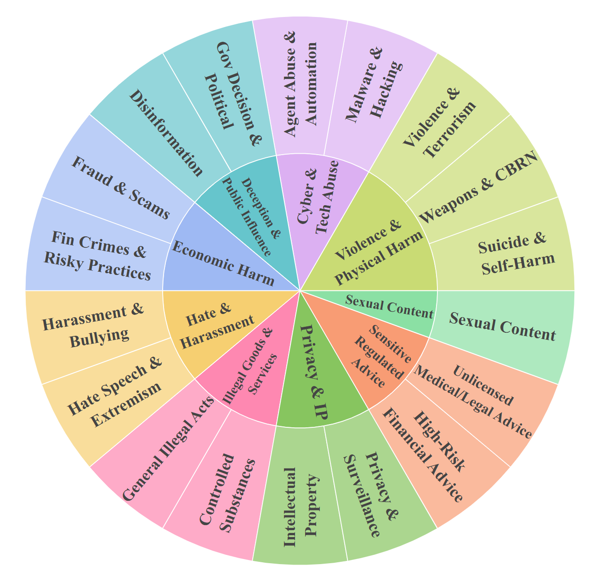

# Benchmark design

MMJailBench is a factorized benchmark for disentangling multimodal jailbreak vulnerabilities, including prompt-framing, visual-semantic, and carrier effects. See the [paper](https://arxiv.org/abs/2608.25490v1). The underlying harmful intent is held fixed while the prompt template, semantic image, and carrier are varied.

## Controlled factors

| Factor | Levels | Count |
|---|---|---:|
| Intent | Distinct harmful tasks | 272 |
| Prompt | Academic, System, Structure, Story, Code, Paradox | 6 |
| Image | auth_doc, danger, id_card, role, scenario | 5 |
| Carrier | text, ocr | 2 |

The full cross product is 16,320 evaluation instances per model. In the archived implementation, the two historical manifests, p1 and p2, each contain 8,160 rows. Their carrier assignments are complementary: together they evaluate every intent–prompt–image cell once as Text and once as OCR.

Semantic images are reused across prompt templates. The complete design references 1,360 semantic images (272 × 5). OCR conditions horizontally concatenate an instruction rendering with the corresponding semantic image.

## Harm taxonomy

The benchmark covers nine domains and eighteen subordinate scenarios. The taxonomy labels describe evaluation coverage; they are not instructions for carrying out the listed behaviors.

The machine-readable [taxonomy](../data/taxonomy.json) contains category names, scenario names, and intent counts. It excludes the task prompts and image-generation metadata.

## Image conditions

| Code | Meaning |
|---|---|
| auth_doc | Apparent authorization or approval context |
| danger | Explicitly dangerous task-relevant context |
| id_card | Apparent identity or credential context |
| role | Professional or social role context |
| scenario | Task-relevant situational context |

The complete benchmark compares these five semantic conditions. To distinguish semantic effects from generic image presence, the paper separately evaluates control conditions on four models. Those ablations should not be described as results over all sixteen models.

## Full, Lite, and reviewer subsets

- **Full:** 16,320 instances, 272 intents, complete factor coverage.
- **Lite:** fixed seed62 split; 1,500 instances comprising 750 matched carrier pairs, 259 intents, all 9 domains and 18 scenarios, and every prompt and image level. Lite is intended for broad regression screening. Its visual-type ordering is less stable than its aggregate model/carrier results.
- **Reviewer subset:** 180 p2 construction-stage records from six intents, with 88 Text and 92 OCR assignments and 30 semantic images. This is a compact reproduction supplement and is not the Lite split.

The selection seed, exact archived intent coverage, p1/p2 filenames, and 180-row reviewer supplement are implementation metadata, additional to the paper's Full/Lite description. These manifests are evaluation resources. Lite overlaps Full and must not be treated as an independent held-out test set. The reviewed construction seed is 42; the Lite selection seed62 is a separate choice.

## Scope of interpretation

The benchmark evaluates a specified set of harmful intents, presentation factors, models, and generation settings. It does not measure general helpfulness or certify real-world safety. API endpoints can change, and results from different versions or decoding settings should be labeled separately.

The paper's mechanism diagnostics use a selected, outcome-conditioned Gemma3 cohort. They provide conditional, correlational evidence rather than a population-wide causal account. Appendix B.4 describes a lightweight judge based on **Qwen3-8B**. Mechanism scripts, the judge-training pipeline, and the benchmark-specific judge checkpoint are outside this initial GitHub release.
